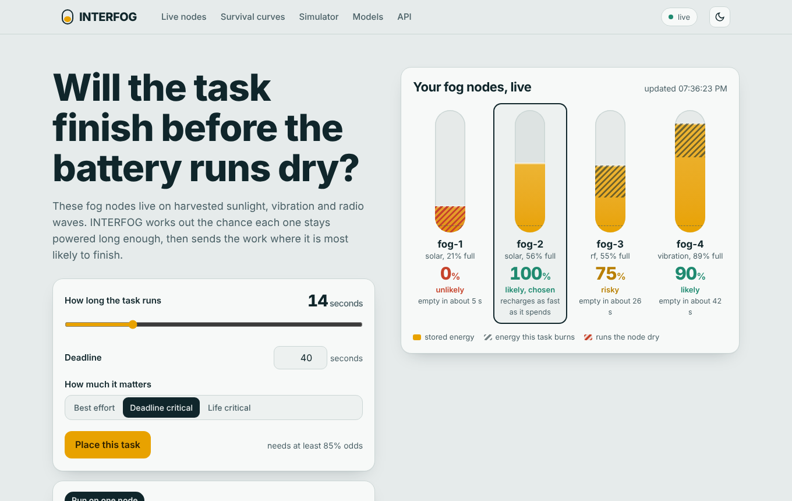

# INTERFOG — Intelligent Energy-Aware Fog Computing Scheduler

<h1 align="center">INTERFOG</h1>
<p align="center"><b>Will the task finish before the battery runs dry?</b><br>
Probability-of-completion scheduling for fog nodes powered by harvested energy.</p>



### Probability-of-Completion Scheduling for Energy-Harvesting Fog Nodes

**INTERFOG** is an intelligent edge/fog computing platform that predicts whether an energy-constrained fog node can complete a task before its available power is exhausted — and dynamically selects the safest execution strategy.

> **Core idea:** *Will the task finish before the battery runs dry?*

Instead of blindly executing workloads, INTERFOG combines **survival analysis, energy forecasting, probabilistic calibration, intelligent scheduling, simulation, and real-time monitoring** to make energy-aware execution decisions.

---

## 🚀 Live Demo

### [🌐 Launch INTERFOG Live Demo](https://interfog.onrender.com/)

The deployed application provides a real-time dashboard for monitoring fog nodes, evaluating task completion probability, comparing scheduling strategies, and observing intelligent execution decisions.

### 🔗 [GitHub Repository](https://github.com/shreyakhadekar-dev/interfog)

---

## 🎯 Why INTERFOG?

Energy-harvesting edge and fog devices may operate using:

- ☀️ Solar energy
- 📳 Vibration
- 📡 RF / radio-frequency harvesting
- 🔋 Intermittent battery storage

Because available energy is unpredictable, a task that looks executable at one moment may fail before completion.

INTERFOG addresses this problem by estimating:

**P(Task Completion | Battery, Harvest Rate, Load, Execution Time, Deadline)**

and converting that prediction into an actionable scheduling decision.

---

## 🧠 Intelligent Decision Engine

For every incoming task, INTERFOG evaluates the current state of available fog nodes and selects one of six execution strategies:

| Decision | Purpose |
|---|---|
| ▶️ Execute | Run the task immediately |
| ⏳ Delay | Wait for better energy availability |
| 🔄 Checkpoint & Migrate | Save progress and move execution |
| 🧬 Replicate | Run redundant copies for reliability |
| 🤝 Offload to Peer | Transfer execution to another fog node |
| ☁️ Cloud Fallback | Escalate the workload to the cloud |

The scheduler optimizes a configurable objective:

**Score = α·P − β·L − γ·E − δ·M − ε·C − ζ·V**

where the system balances completion probability, latency, energy consumption, migration cost, cloud cost, and execution variability.

---

# 🏗️ System Architecture

```text
                    ┌──────────────────────┐
                    │   Fog Node Telemetry │
                    │ Battery / Harvest /  │
                    │ Load / Task State    │
                    └──────────┬───────────┘
                               │
                               ▼
                    ┌──────────────────────┐
                    │  Feature Processing  │
                    │ Energy + Workload    │
                    │ State Representation │
                    └──────────┬───────────┘
                               │
                ┌──────────────┴──────────────┐
                ▼                             ▼
      ┌──────────────────┐          ┌──────────────────┐
      │ Survival Models  │          │ Energy Forecasts │
      │ Weibull AFT       │          │ EWMA             │
      │ Cox PH            │          │ Damped Holt      │
      │ DeepSurv         │          │ Autoregressive   │
      └────────┬─────────┘          └────────┬─────────┘
               │                             │
               └──────────────┬──────────────┘
                              ▼
                    ┌──────────────────────┐
                    │ Probability          │
                    │ Calibration          │
                    │ Platt / Temperature  │
                    │ / Isotonic           │
                    └──────────┬───────────┘
                               │
                               ▼
                    ┌──────────────────────┐
                    │ Intelligent          │
                    │ Scheduler            │
                    └──────────┬───────────┘
                               │
            ┌──────────┬───────┼────────┬──────────┐
            ▼          ▼       ▼        ▼          ▼
         Execute     Delay  Migrate  Replicate   Offload
                                                   │
                                                   ▼
                                             Cloud Fallback
```

---

# 🤖 Machine Learning & Decision Intelligence

INTERFOG integrates multiple statistical and machine-learning approaches rather than relying on a single prediction model.

### Survival Analysis

The system supports:

- **Weibull Accelerated Failure Time (AFT)**
- **Cox Proportional Hazards**
- **DeepSurv**

These models estimate the probability that a fog node remains operational long enough to complete a workload.

### Probability Calibration

Raw model probabilities are calibrated using:

- Platt Scaling
- Temperature Scaling
- Isotonic Regression

This improves the reliability of probability-based decisions.

For example:

> If the system reports **80% completion probability**, the calibrated probability is intended to correspond meaningfully to an approximately 80% observed completion rate.

### Energy Forecasting

INTERFOG supports multiple forecasting approaches:

- EWMA
- Damped Holt
- Autoregressive forecasting

The forecasting strategy can be selected according to node behavior.

---

# 📊 Real-Time Dashboard

The web dashboard provides a centralized view of the entire scheduling system.

### Dashboard capabilities

- 🔋 Live battery monitoring
- ⚡ Energy harvesting monitoring
- 📈 Survival probability visualization
- 📊 Node availability analysis
- 🧠 ML model selection
- 🎯 Task scheduling decisions
- 🔄 Checkpoint and migration decisions
- ☁️ Cloud fallback monitoring
- 🧪 Scenario simulation
- 📡 Real-time WebSocket updates
- 📝 Decision reasoning feed

The dashboard is served directly by the Python backend, making the application lightweight and easy to deploy.

---

# 🧪 Scenario Simulator

INTERFOG includes scenarios **S1–S7** for evaluating scheduling behavior under different energy and workload conditions.

The simulator compares multiple strategies using:

- Identical workloads
- Identical scenario conditions
- Hidden battery/energy behavior
- Completion outcomes
- Scheduling decisions

This enables controlled evaluation of the scheduling algorithms without changing the underlying task conditions.

---

# 🔌 REST API

The application exposes a REST API for programmatic interaction.

| Endpoint | Purpose |
|---|---|
| `POST /api/v1/telemetry` | Submit node battery, harvest and workload telemetry |
| `GET /api/v1/availability` | Calculate node survival probability |
| `POST /api/v1/tasks` | Submit a task and receive a scheduling decision |
| `POST /api/v1/tasks/reassess` | Re-evaluate a running task |
| `POST /api/v1/outcomes` | Report task completion outcomes |
| `POST /api/v1/models/train` | Train available survival models |
| `POST /api/v1/models/activate` | Activate a trained model |
| `POST /api/v1/models/calibrate` | Calibrate model probabilities |
| `POST /api/v1/simulate` | Run scheduling simulations |
| `GET /health` | Application health check |
| `WS /ws` | Real-time node and decision updates |

### Example Task Request

```bash
curl -X POST http://localhost:8000/api/v1/tasks \
  -H "Content-Type: application/json" \
  -d '{
    "exec_time_s": 8,
    "deadline_s": 25,
    "criticality": "deadline_critical"
  }'
```

---

# 🛠️ Technology Stack

### Backend

- Python
- FastAPI
- Pydantic
- Uvicorn
- REST APIs
- WebSockets

### Machine Learning / Data Science

- Survival Analysis
- Weibull AFT
- Cox PH
- DeepSurv
- Probability Calibration
- Time-Series Forecasting
- Statistical Decision Modeling

### Frontend

- HTML5
- CSS3
- JavaScript
- Real-time WebSocket visualization

### Testing

- Pytest
- HTTPX
- Automated API tests

### Deployment

- Render
- GitHub
- Render Blueprint
- `render.yaml`

---

# 📁 Project Structure

```text
INTERFOG/
│
├── app/
│   ├── __init__.py
│   ├── core.py              # Data models, node state, scheduler & metrics
│   ├── main.py              # FastAPI application, REST API & WebSocket
│   ├── ml.py                # Survival models, calibration & forecasting
│   ├── simulate.py          # S1–S7 scenarios & strategy comparison
│   │
│   └── static/
│       └── index.html       # Interactive dashboard
│
├── docs/
│   ├── ARCHITECTURE.md
│   ├── INTERFOG_Project_Review1.pptx
│   ├── INTERFOG_Research_Proposal.docx
│   ├── architecture_diagram.png
│   └── dashboard.png
│
├── tests/
│   ├── __init__.py
│   └── test_interfog.py
│
├── .gitignore
├── LICENSE
├── README.md
├── pytest.ini
├── render.yaml
└── requirements.txt
```

---

# ⚡ Run Locally

### 1. Clone the repository

```bash
git clone https://github.com/shreyakhadekar-dev/interfog.git
cd interfog
```

### 2. Create a virtual environment

#### Windows

```powershell
python -m venv .venv
.venv\Scripts\activate
```

#### Linux / macOS

```bash
python3 -m venv .venv
source .venv/bin/activate
```

### 3. Install dependencies

```bash
pip install -r requirements.txt
```

### 4. Start the application

```bash
uvicorn app.main:app --reload
```

### 5. Open the application

Dashboard:

```text
http://localhost:8000
```

Interactive API documentation:

```text
http://localhost:8000/docs
```

Health check:

```text
http://localhost:8000/health
```

The application starts with four demo fog nodes, allowing the dashboard to be explored immediately.

---

# ☁️ Deploy on Render

INTERFOG includes a `render.yaml` Blueprint configuration for simplified deployment.

### Option 1 — Render Blueprint

1. Fork or clone the repository.
2. Connect the GitHub repository to Render.
3. Select **New → Blueprint**.
4. Select the repository.
5. Apply the Blueprint.
6. Wait for the deployment to complete.
7. Open the generated Render URL.

### Option 2 — Manual Web Service

**Build Command**

```bash
pip install -r requirements.txt
```

**Start Command**

```bash
uvicorn app.main:app --host 0.0.0.0 --port $PORT --proxy-headers --forwarded-allow-ips '*'
```

---

# 🧪 Testing

Install the testing dependencies:

```bash
pip install pytest httpx
```

Run the complete test suite:

```bash
python -m pytest -q
```

The project includes automated tests covering core application and API behavior.

---

# ⚙️ Configuration

INTERFOG supports environment-based configuration for deployment and experimentation.

Examples include:

```text
ENABLE_DEMO
CORS_ORIGINS
ALPHA
BETA
GAMMA
DELTA
EPSILON
ZETA
P_MIN_LIFE_CRITICAL
P_MIN_DEADLINE_CRITICAL
P_MIN_BEST_EFFORT
CLOUD_ENABLED
CLOUD_LATENCY_MS
DELAY_WINDOW_S
```

The complete configuration is defined in:

```text
app/core.py
```

---

# 🔬 Engineering Highlights

INTERFOG demonstrates practical implementation of:

- Energy-aware edge/fog computing
- Probabilistic task scheduling
- Survival analysis
- Machine-learning model comparison
- Probability calibration
- Time-series energy forecasting
- Multi-objective optimization
- Real-time WebSocket communication
- RESTful API design
- Automated testing
- Scenario-based simulation
- Cloud fallback strategies
- Production-style deployment with Render

---

# 💡 Key Engineering Challenge

Traditional schedulers primarily ask:

> **"Can this node execute the task?"**

INTERFOG asks a more useful question:

> **"What is the probability that this node will still have enough energy to finish the task before its deadline?"**

That shift from **binary availability** to **probabilistic completion-aware scheduling** is the central design principle behind INTERFOG.

---

# 🌐 Project Links

| Resource | Link |
|---|---|
| 🚀 Live Application | https://interfog.onrender.com/ |
| 💻 GitHub Repository | https://github.com/shreyakhadekar-dev/interfog |
| 📚 API Documentation | `/docs` on the deployed application |
| ❤️ Health Check | `/health` on the deployed application |

---

# 👩‍💻 Author

**Shreya Khadekar**

Computer Science & Engineering  
Vellore Institute of Technology

INTERFOG was developed as an engineering project exploring the intersection of:

**Machine Learning × Edge Computing × Energy Harvesting × Intelligent Scheduling × Cloud Computing**

---

# 📄 License

This project is released under the **MIT License**.

---

## ⭐ If you find this project interesting

Explore the live system, inspect the architecture, experiment with the API, and review the implementation on GitHub.

**INTERFOG — making fog computing decisions before the battery runs dry.**
